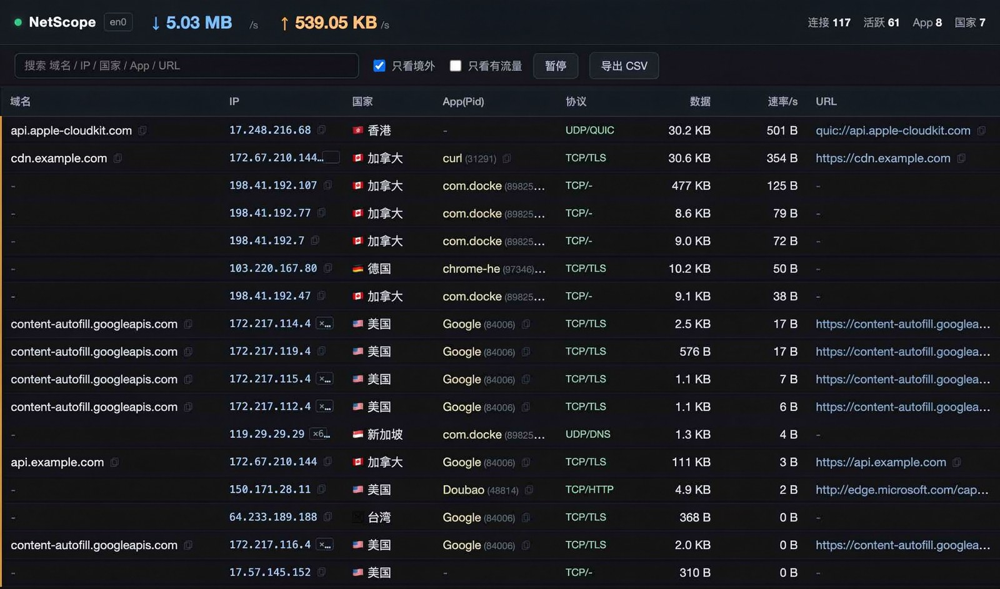

# NetScope

**In one sentence: see exactly who this computer is talking to right now — where, which country, which app, and how fast.**

A single-binary, fully local tool. Packet capture and analysis happen in memory on this machine; the UI is a browser page. No cloud, no uploads, no database.

Chinese: [README.zh-CN.md](README.zh-CN.md)



<sub>Real screenshot from a macOS run. Hostnames and app names were masked before publication.</sub>

---

## 1. The problem it solves

Most people have only a vague idea of what their computer is doing on the network. Built-in tools give you either a total throughput number (Activity Monitor) or a wall of IPs (`netstat`) — never the full picture of *who is connecting, to where, and how fast*. NetScope puts all of it in one table:

| Your question | The answer in the table |
| --- | --- |
| Where is it connecting? | `Domain` + `IP` columns |
| Which country? | `Country` (flag + name; private ranges show `LAN`) |
| Which app? | `App(Pid)` (process name + PID; hover for full path, click to copy) |
| How fast is it now? | `Rate/s` column + global rates + 60-second sparkline |
| What kind of traffic? | `Protocol` (`TCP/TLS`, `TCP/HTTP`, `UDP/QUIC`, `UDP/DNS`) |
| Which exact URL? | `URL` (full URL for plaintext HTTP, `https://domain` for encrypted) |
| How much data? | `Data` column (cumulative bytes; hover for up/down split) |

---

## 2. Features

### Real-time connection dashboard

- **Full DNS observation**: sniffs UDP/53 and TCP/53 queries and responses, parses qname / qtype / A / AAAA, and builds an `IP ↔ domain` map with TTL expiry.
- **Full TCP observation**: every TCP segment is aggregated into bidirectional 5-tuple flows with byte/packet counters, first/last timestamps, and TCP state (SYN / ESTABLISHED / CLOSING / RESET).
- **Three-tier domain resolution**: TLS ClientHello SNI (most accurate) → DNS answer mapping → QUIC Initial SNI. Left blank rather than guessed.
- **App attribution**: local port → process (`lsof` / `/proc` / Windows IP Helper API), plus the executable's full path via `proc_pidpath` (macOS), `/proc/pid/exe` (Linux), `GetProcessImageFileName` (Windows).
- **Offline GeoIP**: DB-IP Lite country database, auto-downloaded on first run (~4 MB, no signup), then queried purely locally.
- **Rate calculation**: 1-second delta + 5-second sliding window + EWMA smoothing — per row and globally, without the numbers flickering.
- **Row aggregation**: connections sharing the same `domain + IP` merge into one row (bytes and rate summed, `×N` shows how many), so short-lived connections don't flood the table.

### UI interactions

- All eight columns sortable; one search box matches domain / IP / country / app / URL at once
- **`Foreign only`** — one click to isolate connections outside mainland China and outside your LAN (the most useful filter)
- **`Active only`** — hide flows that have gone quiet
- Pause / resume, CSV export
- Copy icons on Domain / IP / App / URL (click to copy; **no icon when the field is empty**)
- Dark theme; 5000-row cap with LRU eviction; sorted by rate by default — the first screen is always "what's eating bandwidth right now"
- Thin orange bar on rows that go abroad

---

## 3. Highlights

| Highlight | Detail |
| --- | --- |
| **Single binary** | Front-end embedded via `go:embed` — no Node, npm, or web server needed |
| **No external services** | No Redis, Elasticsearch, or database. The only runtime dependency is the OS packet capture library |
| **Nothing leaves the machine** | Capture, parsing and geolocation are all local; GeoIP is a local mmdb, no online API calls |
| **Cross-platform** | macOS / Linux / Windows share one codebase; only permissions and the capture driver differ |
| **Lightweight** | Tens of thousands of pps on a single core; memory holds only the flow table (cap configurable) |
| **Non-intrusive** | Purely passive: not a proxy, no MITM, no root certificate, never blocks a connection |
| **Verifiable** | Every row traces to a process, an IP, a domain, a byte count and a rate — exportable to CSV for cross-checking |
| **Portable** | Cross-compiles to Linux / Windows as a distributable single file |

---

## 4. Dependencies

### Runtime

| Platform | Capture library | Permission |
| --- | --- | --- |
| macOS | Built-in libpcap / BPF | Join the `access_bpf` group for sudo-free operation; otherwise run with `sudo` |
| Linux | libpcap (`libpcap.so`) | root, or grant `cap_net_raw,cap_net_admin` to the binary |
| Windows | **Npcap** (WinPcap API compatible mode) | Run as Administrator (or allow non-admin during Npcap install) |

Sudo-free on macOS (recommended, one-time, re-login required):

```bash
sudo dseditgroup -o edit -a "$(whoami)" -t user access_bpf
```

Sudo-free on Linux:

```bash
sudo setcap cap_net_raw,cap_net_admin+ep ./netscope
```

### Build-time

| Dependency | Notes |
| --- | --- |
| Go | 1.21+ (developed on 1.27) |
| C compiler | macOS: Xcode Command Line Tools; Linux: gcc; Windows: mingw-w64 |
| libpcap headers | Bundled with the macOS SDK; Linux: `apt install libpcap-dev` |
| Npcap SDK | Only for Windows builds / cross-compilation |

Go modules (fetched by `go mod tidy`):

- `github.com/gopacket/gopacket` — packet decoding and pcap binding
- `github.com/oschwald/maxminddb-golang` — GeoIP database reader
- `github.com/shirou/gopsutil/v4` — process/connection enumeration on Windows only

---

## 5. Build

```bash
cd NetScope

make build        # same as: go build -trimpath -ldflags "-s -w" -o netscope ./cmd/netscope
# or
go build -o netscope ./cmd/netscope
```

Output: `./netscope` (macOS/Linux) or `netscope.exe` (Windows).

Prebuilt binaries: every tag `v*` is compiled by [`.github/workflows/release.yml`](.github/workflows/release.yml)
on GitHub Actions and attached to [Releases](https://github.com/hktalent/NetScope/releases) —
macOS (arm64 / amd64), Linux (amd64 / arm64) and Windows (amd64), each archive shipped with a
`.sha256` checksum. Build version is embedded: `./netscope -version`.

Cross-compilation:

```bash
make build-linux                               # needs x86_64-linux-gnu-gcc + Linux libpcap headers
make build-win NPCAP_SDK=/path/to/npcap-sdk     # needs mingw-w64 + Npcap SDK
```

> Because of cgo and the `wpcap` dependency, the most reliable Windows build is **`go build` on a Windows machine** (with mingw and the Npcap SDK installed).

---

## 6. Run

```bash
# Simplest: auto-select the default-route interface, listen on 127.0.0.1:8899
./netscope

# Explicit interface and port
./netscope -iface en0 -port 8899

# Disable GeoIP (no download, no Country column)
./netscope -no-geo

# List interfaces (useful when the auto-pick looks wrong)
./netscope -list
```

Then open **http://127.0.0.1:8899**. On first run the GeoIP country database is downloaded into `data/`.

### Flags

| Flag | Default | Description |
| --- | --- | --- |
| `-iface` | `auto` | Interface name; `auto` = the default-route interface |
| `-port` | `8899` | Web port (binds to 127.0.0.1 only) |
| `-top` | `300` | Max rows per SSE push |
| `-max` | `5000` | Max connections kept in memory (least-recently-active evicted first) |
| `-geo` | `data/dbip-country-lite.mmdb` | GeoIP database path |
| `-no-geo` | `false` | Disable GeoIP |
| `-lsof` | `3s` | Process attribution sampling interval |
| `-list` | `false` | Print interfaces and exit |

### HTTP endpoints

| Path | Description |
| --- | --- |
| `/` | Dashboard page |
| `/api/snapshot?top=N` | Current snapshot (JSON) |
| `/api/stream` | SSE stream, one frame per second (auto-reconnects) |
| `/api/export.csv` | Export the current table |

---

## 7. Limitations (please read)

- **HTTPS reveals the domain only, never the path**: the domain comes from TLS SNI. Getting the path would require MITM with a trusted certificate — contrary to this project's passive-only design, so it's intentionally unsupported.
- **DoH / DoT is invisible**: those lookups run over encrypted 443/853 channels; you only see "connected to some encrypted DNS provider". The domain is then recovered from SNI.
- **This machine only**: includes VPN `utun` interfaces and VM bridges, but **not** the whole LAN. Monitoring other devices requires a switch mirror port (SPAN/TAP).
- **Connections established before startup lack context**: their ClientHello / DNS was never seen, so the domain may be blank. New connections resolve normally.
- **Root processes are invisible without privileges**: non-root `lsof` cannot enumerate system process sockets, so their App column stays `-`. Run with `sudo` for full coverage.
- **UDP is limited to DNS(53) and QUIC(443)**: keeps mDNS, SSDP and broadcast noise out of the table.
- **Private addresses skip GeoIP**: `10/8`, `172.16/12`, `192.168/16`, loopback and link-local all show as `LAN`.

---

## 8. Layout

```
cmd/netscope/        Entry point: flags, wiring, signal handling
internal/capture/    pcap capture, BPF filter, packet decoding, default-interface detection
internal/flow/       Bidirectional 5-tuple aggregation, rate math, LRU eviction, domain+IP merging
internal/dnsmap/     DNS answers → IP↔domain map (TTL aware)
internal/sni/        TLS ClientHello → SNI / ALPN
internal/httpurl/    Plaintext HTTP request line + Host → full URL
internal/geo/        DB-IP Lite lookups + auto-download
internal/proc/       Local port → process name / PID / executable path
internal/server/     HTTP + SSE + CSV export
web/                 Embedded front-end (HTML / CSS / JS, no build step)
data/                GeoIP country database (auto-downloaded, safe to delete)
```

---

## 9. FAQ

**`bind: address already in use` on startup?**
Another instance is running. `pkill -x netscope`, then start again (the listener retries on port release, so a quick restart won't fail).

**No data captured?**
Run `./netscope -list` to check the interface name; with a VPN you usually need `utunN` rather than `en0`.

**Country column is all `-`?**
The GeoIP database failed to download. Fetch <https://download.db-ip.com/free/dbip-country-lite-2026-11.mmdb.gz> manually and extract it to `data/dbip-country-lite.mmdb`.

**App column mostly empty?**
Non-root runs can't see system processes. `sudo ./netscope` greatly improves coverage.

---

## 10. Privacy

- All analysis happens in local memory; **nothing is sent anywhere** (GeoIP is a local mmdb file).
- The web UI binds to `127.0.0.1` only and has no authentication by default — do not expose the port to the internet.
- Packets are only counted in memory; **no pcap is written to disk**, and everything is cleared on exit.

## License

MIT (see the LICENSE file in the repository).
