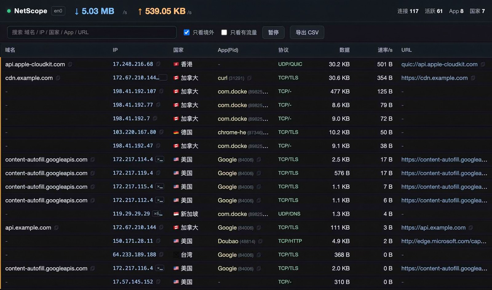

# NetScope

**一句话：看清这台电脑此刻到底在连谁 —— 连哪儿、对方在哪个国家、是哪个 App、有多快。**

纯本地运行的单二进制程序：抓包与分析全在本机内存里完成，界面是一个浏览器页面，不联网、不上传、不需要数据库。

English: [README.md](README.md)



<sub>真实运行截图（macOS），发布前已对域名与程序名做脱敏处理。</sub>

---

## 一、它解决什么问题

绝大多数人对自己电脑的网络行为只有一个模糊印象。系统自带工具要么只给总量（活动监视器），要么只给一行行 IP（`netstat`），拼不出「谁在连、连去哪、快不快」这张完整的图。NetScope 把这几个问题放进同一张表：

| 你心里的问题 | 表格里的答案 |
| --- | --- |
| 它在连哪儿？ | `域名` + `IP` 两列 |
| 对方在哪个国家？ | `国家`（国旗 + 中文国名；内网显示"局域网"） |
| 哪个 App 在连？ | `App(Pid)`（进程名 + PID，悬停看完整路径，点击复制路径） |
| 现在有多快？ | `速率/s` + 顶栏总速率 + 60 秒速率曲线 |
| 连的是什么东西？ | `协议`（`TCP/TLS`、`TCP/HTTP`、`UDP/QUIC`、`UDP/DNS`） |
| 具体哪个地址？ | `URL`（明文 HTTP 给完整 URL，加密流给 `https://域名`） |
| 这条连接灌了多少数据？ | `数据` 列（累计字节，悬停看上下行分列） |

---

## 二、功能

### 实时连接看板

- **DNS 全量观测**：嗅探 UDP/53 与 TCP/53 的请求与应答，解析 qname / qtype / A / AAAA，建立 `IP ↔ 域名` 映射（带 TTL 过期）。
- **TCP 全量观测**：所有 TCP 段按双向五元组聚合为"连接"，累计收发字节、包数、首末时间、TCP 状态（SYN / ESTABLISHED / CLOSING / RESET）。
- **域名识别三级兜底**：TLS ClientHello 的 SNI（最准）→ DNS 应答映射 → QUIC Initial 的 SNI；都取不到时留空，不猜。
- **App 归因**：本地端口 → 进程（`lsof` / `/proc` / Windows IP Helper API），并用 `proc_pidpath`（macOS）、`/proc/pid/exe`（Linux）、`GetProcessImageFileName`（Windows）取可执行文件完整路径。
- **GeoIP 离线查询**：DB-IP Lite 国家库，首次启动自动下载（约 4 MB，免注册），之后全程本地查询。
- **速率计算**：1 秒差分 + 5 秒滑动窗口 + EWMA 平滑，逐行与全局同时给出，数字不跳。
- **聚合显示**：同一「域名 + IP」的多条连接合并为一行（数据与速率累加，`×N` 标注合并条数），避免短连接刷屏。

### 界面交互

- 八列均可排序；单框搜索同时命中 域名 / IP / 国家 / App / URL
- **`只看境外`** —— 一键筛出非中国大陆、非局域网的连接（最实用的一项）
- **`只看有流量`** —— 过滤已静默的连接
- 暂停 / 恢复、导出 CSV
- 域名、IP、App、URL 四列带复制图标（单击写入剪贴板；**无数据的行不显示图标**）
- 深色界面；5000 行上限 + LRU 淘汰，默认按速率降序——第一屏永远是"此刻正在吃带宽的"
- 境外行左侧橙色竖条标记

---

## 三、特点

| 特点 | 说明 |
| --- | --- |
| **单二进制** | 前端用 `go:embed` 打进可执行文件，不需要 Node / npm / Web 服务器 |
| **零外部依赖** | 不需要 Redis、Elasticsearch、数据库；唯一运行时依赖是系统抓包库 |
| **零数据外发** | 抓包、解析、地理查询全在本机；GeoIP 是本地 mmdb，不调用在线 API |
| **跨平台** | macOS / Linux / Windows 同一套代码，差异只在权限与抓包驱动 |
| **轻量** | 单核可处理数万 pps；内存只保留连接表（上限可配） |
| **不改变你的网络** | 纯被动监听：不是代理、不做 MITM、不装根证书、不阻断任何连接 |
| **可核对** | 每行都能追到「哪个进程、哪个 IP、哪个域名、多少字节、多少速率」，并可 CSV 导出复核 |
| **可移植** | 交叉编译到 Linux / Windows，产物是可分发的单文件 |

---

## 四、依赖

### 运行时依赖

| 平台 | 抓包库 | 权限 |
| --- | --- | --- |
| macOS | 系统自带 libpcap / BPF | 加入 `access_bpf` 组即可免 sudo；否则 `sudo` 运行 |
| Linux | libpcap（`libpcap.so`） | root，或给二进制授予 `cap_net_raw,cap_net_admin` |
| Windows | **Npcap**（WinPcap API 兼容模式） | 管理员运行（或安装 Npcap 时允许非管理员） |

macOS 免 sudo（推荐，只需一次，重新登录生效）：

```bash
sudo dseditgroup -o edit -a "$(whoami)" -t user access_bpf
```

Linux 免 sudo：

```bash
sudo setcap cap_net_raw,cap_net_admin+ep ./netscope
```

### 编译依赖

| 依赖 | 说明 |
| --- | --- |
| Go | 1.21+（开发时使用 1.27） |
| C 编译器 | macOS：Xcode Command Line Tools；Linux：gcc；Windows：mingw-w64 |
| libpcap 开发头文件 | macOS 随 SDK；Linux：`apt install libpcap-dev` |
| Npcap SDK | 仅 Windows 构建/交叉编译时需要 |

Go 模块依赖（`go mod tidy` 自动拉取）：

- `github.com/gopacket/gopacket` —— 报文解析与 pcap 绑定
- `github.com/oschwald/maxminddb-golang` —— GeoIP 库读取
- `github.com/shirou/gopsutil/v4` —— 仅 Windows 的进程/连接枚举

---

## 五、编译

```bash
cd NetScope

make build        # 等价于 go build -trimpath -ldflags "-s -w" -o netscope ./cmd/netscope
# 或
go build -o netscope ./cmd/netscope
```

产物：`./netscope`（macOS/Linux）或 `netscope.exe`（Windows）。

预编译二进制：推 `v*` tag 时由 [`.github/workflows/release.yml`](.github/workflows/release.yml)
在 GitHub Actions 上自动编译并发布到 [Releases](https://github.com/hktalent/NetScope/releases)，
覆盖 macOS（arm64 / amd64）、Linux（amd64 / arm64）、Windows（amd64），每个压缩包都带
`.sha256` 校验值。版本号已写进二进制：`./netscope -version`。

交叉编译：

```bash
make build-linux                               # 需要 x86_64-linux-gnu-gcc + Linux 版 libpcap 头文件
make build-win NPCAP_SDK=/path/to/npcap-sdk    # 需要 mingw-w64 + Npcap SDK
```

> Windows 因 cgo 与 `wpcap` 依赖，最稳的做法是**在 Windows 机器上直接 `go build`**（装 mingw 与 Npcap SDK 即可）。

---

## 六、运行

```bash
# 最基本：自动选择默认路由网卡，监听 127.0.0.1:8899
./netscope

# 指定网卡与端口
./netscope -iface en0 -port 8899

# 关闭 GeoIP（不下载国家库、不显示国家列）
./netscope -no-geo

# 只列出网卡（排查选错网卡时用）
./netscope -list
```

启动后打开 **http://127.0.0.1:8899**。首次运行会在 `data/` 下自动下载 GeoIP 国家库。

### 命令行参数

| 参数 | 默认 | 说明 |
| --- | --- | --- |
| `-iface` | `auto` | 网卡名；`auto` = 默认路由所在网卡 |
| `-port` | `8899` | Web 端口（只监听 127.0.0.1） |
| `-top` | `300` | 每次 SSE 推送的最大行数 |
| `-max` | `5000` | 内存中最多保留的连接数（超出按最久未活动淘汰） |
| `-geo` | `data/dbip-country-lite.mmdb` | GeoIP 库路径 |
| `-no-geo` | `false` | 禁用 GeoIP |
| `-lsof` | `3s` | 进程归因采样间隔 |
| `-list` | `false` | 列出网卡后退出 |

### HTTP 接口

| 路径 | 说明 |
| --- | --- |
| `/` | 看板页面 |
| `/api/snapshot?top=N` | 当前快照（JSON） |
| `/api/stream` | SSE 流，每秒一帧（页面断线自动重连） |
| `/api/export.csv` | 导出当前连接表 |

---

## 七、能力边界（务必知道）

- **HTTPS 只能看到域名，看不到 path**：域名来自 TLS SNI；要看 path 必须 MITM 装证书，与"纯被动"定位冲突，不做。
- **DoH / DoT 的 DNS 不可见**：这类解析走 443/853 加密通道，只能看到"连了某个加密 DNS 服务商"，域名由 SNI 补。
- **只监测本机流量**：包含 VPN 的 `utun`、虚拟机网桥，但**不是**整个局域网；看其他设备需要交换机镜像口（SPAN/TAP）。
- **启动前已建立的连接缺少上下文**：没抓到它们的 ClientHello / DNS，域名可能为空；新连接都会正常带出。
- **普通权限看不到 root 进程**：`lsof` 非 root 无法枚举系统进程 socket，其 App 列为 `-`；需全覆盖请 `sudo` 运行。
- **UDP 只归集 DNS(53) 与 QUIC(443)**：避免 mDNS、SSDP、广播流量把表刷乱。
- **内网地址不查国家**：`10/8`、`172.16/12`、`192.168/16`、回环、链路本地统一显示"局域网"。

---

## 八、目录结构

```
cmd/netscope/        程序入口：参数解析、模块装配、信号处理
internal/capture/    pcap 捕获、BPF 过滤、报文解码、默认网卡探测
internal/flow/       双向五元组聚合、速率计算、LRU 淘汰、域名+IP 合并
internal/dnsmap/     DNS 应答 → IP↔域名 映射（带 TTL）
internal/sni/        TLS ClientHello → SNI / ALPN
internal/httpurl/    明文 HTTP 请求行 + Host → 完整 URL
internal/geo/        DB-IP Lite 查询 + 自动下载
internal/proc/       本地端口 → 进程名 / PID / 可执行文件路径
internal/server/     HTTP + SSE + CSV 导出
web/                 go:embed 的前端（HTML / CSS / JS，无构建链）
data/                GeoIP 国家库（首次运行自动下载，可删除）
```

---

## 九、常见问题

**启动报 `bind: address already in use`？**
已有实例在跑，`pkill -x netscope` 后再启动（程序对端口释放有重试，重复启动不会立刻失败）。

**抓不到任何数据？**
`./netscope -list` 看网卡名；VPN 场景通常要抓 `utunN` 而不是 `en0`。

**国家列全是 `-`？**
GeoIP 库没下载成功，手动下载 <https://download.db-ip.com/free/dbip-country-lite-2026-11.mmdb.gz> 解压为 `data/dbip-country-lite.mmdb`。

**App 列大量为空？**
非 root 运行看不到系统进程，`sudo ./netscope` 可显著提升覆盖率。

---

## 十、数据与隐私

- 所有分析在本机内存完成，**不发送任何数据到外部**（GeoIP 为本地 mmdb 文件）。
- Web 界面只监听 `127.0.0.1`，默认无鉴权——请勿把端口暴露到公网。
- 抓包只在内存中统计，**不落盘 pcap**，退出即清空。

## 许可证

MIT（以仓库内 LICENSE 文件为准）。
